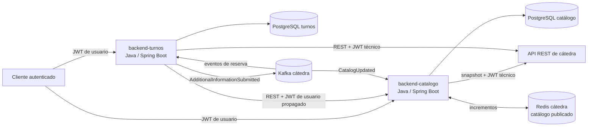
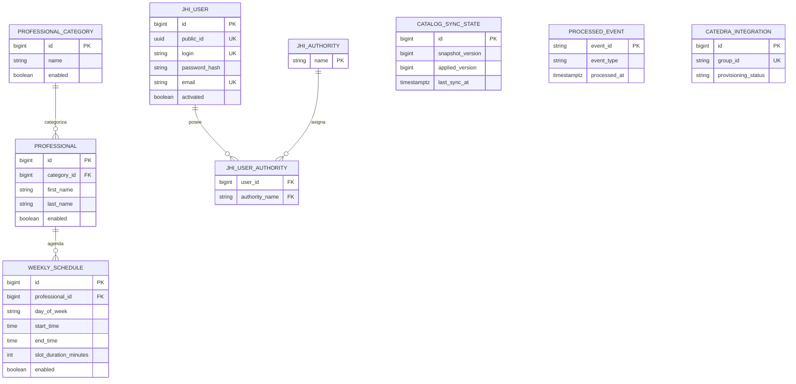

# Arquitectura backend: catálogo y sincronización

## Contexto de integración



Los dos backends tienen bases y migraciones independientes; no hay acceso cruzado a tablas,
repositorios ni entidades. `backend-turnos` obtiene información de agenda exclusivamente por
HTTP desde este servicio. Redis y Kafka pertenecen a la cátedra y no se levantan en local.
Los contratos externos de cátedra se encuentran en `INTEGRATION_REFERENCE-v2.md` del material
del proyecto. Para ejecución conjunta local, ambos Compose se conectan a la red externa
`backend-integration`, que se crea una vez con `docker network create backend-integration`.

## Propiedad y modelo de datos

Este servicio es propietario de:

| Tabla | Responsabilidad |
|---|---|
| `professional_category` | Categorías replicadas, incluidas las deshabilitadas. |
| `professional` | Profesionales y su categoría; los IDs son los provistos por cátedra. |
| `weekly_schedule` | Reglas semanales y estado habilitado. |
| `catalog_sync_state` | Versiones intentada/aplicada y último resultado/error. La versión aplicada identifica exactamente las colecciones persistidas. |
| `processed_event` | Deduplicación durable de `CatalogUpdated` por `eventId`. |
| `jhi_user`, `jhi_authority`, `jhi_user_authority` | Usuarios finales, hash BCrypt y autoridad. |
| `catedra_integration` | Configuración de cuenta técnica; secretos persistidos se cifran. |



Las tablas y restricciones concretas son administradas por `src/main/resources/db/migration`.
El catálogo vigente no se copia a la base de turnos; los nombres guardados en una reserva son
datos descriptivos históricos, no fuente para nuevas consultas.

## Sincronización e idempotencia

1. Una base vacía, una discontinuidad o una versión no verificable dispara un snapshot REST.
   Las tres colecciones y `snapshotVersion` se aplican de forma transaccional.
2. `CatalogUpdated` solo notifica. El consumidor lee metadata y `changes:{version}` en Redis,
   obtiene los IDs afectados de los hashes actuales y aplica versiones en orden.
3. Si la versión local es anterior a `oldestAvailableVersion`, o está por delante de Redis,
   no se intenta saltar versiones: se reconstruye por snapshot.
4. Cada versión incremental se aplica en su propia transacción; los datos cambian y la versión
   aplicada avanza como una sola unidad.
5. El `eventId` se deduplica en PostgreSQL. Los offsets Kafka se confirman solo después de que
   el listener persiste los efectos. Un scheduler compara periódicamente las versiones para
   recuperar notificaciones perdidas.
6. Una falla conserva la última versión aplicada y deja visible el diagnóstico en el endpoint
   de estado; los reintentos no escriben estado parcial.

## Contrato interno consumido por `backend-turnos`

Base URL: `CATALOGO_API_BASE_URL`. Todas las rutas requieren un JWT de usuario válido con
`ROLE_USER`; turnos propaga el JWT autenticado y no manda un `userId` elegido por el cliente.

| Método y ruta | Respuesta exitosa | Errores relevantes |
|---|---|---|
| `GET /api/internal/professionals/{id}` | `200` `{id, categoryId, firstName, lastName, enabled}` | `401` token inválido, `403` rol insuficiente, `404 PROFESSIONAL_NOT_FOUND`. |
| `GET /api/internal/professionals/{id}/weekly-schedules?date=yyyy-MM-dd` | `200` lista de `{dayOfWeek, startTime, endTime, slotDurationMinutes}`. `date` es opcional; sin fecha se devuelven días para rango. | `401`, `403`, `404 PROFESSIONAL_NOT_FOUND`; validación de fecha inválida `400`. |

Los errores HTTP usan `application/problem+json` y un `code` funcional. Turnos traduce
indisponibilidad/red/`5xx` a `503 CATALOG_UNAVAILABLE`, respuestas malformadas a
`502 CATALOG_INVALID_RESPONSE`, y auth a `CATALOG_AUTH_FAILED`/`CATALOG_ACCESS_DENIED`.
Si catálogo no está disponible, turnos no puede iniciar operaciones que requieren agenda
vigente.

## Usuarios, seguridad y transporte

- `POST /api/register` crea usuarios finales activos; `POST /api/authenticate` emite JWT HS256
  del issuer `backend-catalogo`. La contraseña se guarda con BCrypt y nunca se devuelve.
- `publicId` es el identificador estable compartido con turnos como `externalPatientId`.
  Autoridades y datos de identidad se obtienen del JWT validado, no de campos de la petición.
- El JWT técnico de cátedra es una identidad diferente y no se entrega a clientes finales.
  Secretos y configuración se inyectan desde variables de entorno; `.env` está ignorado y los
  valores en `.env.example` son ficticios.
- El Compose local limita HTTP y PostgreSQL a `127.0.0.1`. En despliegue se exige ingress con
  TLS y red privada para puertos de backend y base de datos. `CATALOGO_API_BASE_URL` debe usar
  HTTPS; `server.forward-headers-strategy=framework` solo es seguro detrás de un proxy de
  confianza que no pueda ser sorteado.
- CORS se limita a `CORS_ALLOWED_ORIGINS`.

## Pruebas

```bash
./mvnw test
```

Testcontainers requiere Docker para pruebas de PostgreSQL/Redis. La suite cubre snapshot,
incrementos ordenados, fallback por discontinuidad, deduplicación Kafka, búsqueda, registro,
JWT y autorización.
